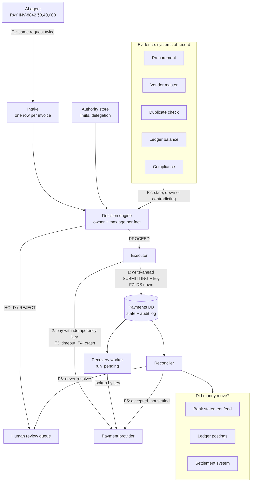
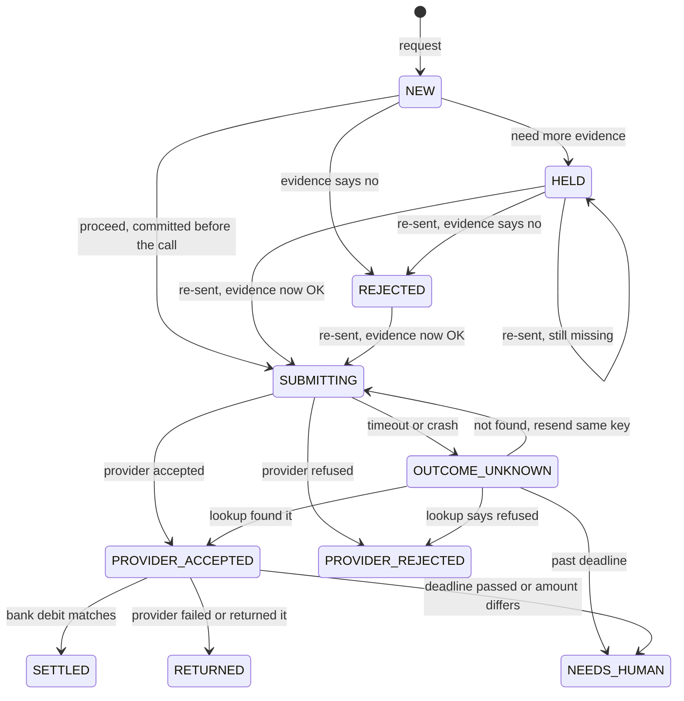

# Architecture (Part 4)

## Components

In the prototype: `decision.py` is the decision engine, `service.py` holds the intake, executor, recovery worker and reconciler, and `store.py` is the payments DB with its audit log. The external systems are fakes in `fakes.py`.

## Where it can fail

| # | Where | What goes wrong | What the system does |
|---|---|---|---|
| F1 | Intake | The same request arrives twice, maybe at the same moment | `invoice_id` is UNIQUE, so the existing row is returned. A compare-and-set on `version` lets only one worker send. |
| F2 | Evidence | A source is stale or down, or the agent's claims contradict it | Hold. Stale or missing data never satisfies a check, and agent claims never count as evidence. |
| F3 | Provider call | Timeout after the provider executed | `OUTCOME_UNKNOWN`, then a lookup by key. A resend only ever uses the same key. |
| F4 | Executor process | Crash between the write-ahead and the response | The row stays `SUBMITTING`. Recovery treats it as unknown and looks it up. |
| F5 | Downstream | The provider says ACCEPTED, but the bank hasn't confirmed | `PROVIDER_ACCEPTED`, shown as "settlement pending". It's reconciled until the bank debit appears. |
| F6 | Reconciler | The disagreement never resolves | `NEEDS_HUMAN` after a deadline. No automatic re-pay, and no automatic "complete". |
| F7 | Payments DB | It's down, or the write fails | No write-ahead means no provider call. The system fails closed. |
| F8 | Between decision and payment | The bank details change after the check | The payment goes to the account captured at decision time, and deciding and sending happen in one step. A small window remains (see the final questions). |

## Payment states

**The rule:** anything before `SUBMITTING` can be assessed again, because nothing has been sent. From `SUBMITTING` onward, the payment is tied to its idempotency key, and only the recovery worker and the reconciler move it.

## Running this on Temporal

This is how I'd build it for real, since it's what I use at work. I kept the prototype to plain Python and SQLite so the failure handling is visible and runs without a server.

- **One workflow per invoice**, with workflow ID `payment-INV-8842`. Temporal refuses a second start with the same ID, which handles Case A.
- **Activities, timers and signals.** Assessment, pay, lookup and the reconciliation reads are activities. The settlement deadline is a durable timer. Signals carry webhooks and a person's decision on a hold.
- **What Temporal doesn't fix.** It makes *my* code durable, not the provider call. An activity that timed out may still have executed at the provider, and Temporal will retry it. So the pay activity still needs the idempotency key and the same "look up first, then resend with the same key" logic as `_resolve_unknown`. Definitive rejections are marked non-retryable in the activity's retry policy.
